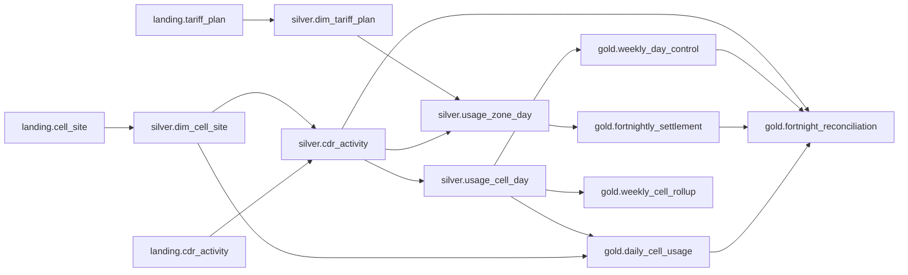

# ninebar: incremental, replay-safe CDR pipeline (option 2)

A batch pipeline over the Telecom Italia Big Data Challenge "SMS, Call, Internet" data (Milano + Trentino) that:

- lands every file immutably with a manifest, and processes only what changed (hash keys per source partition)
- cleans and validates against versioned contracts, with every rejected line kept in a quarantine table along with its reasons
- detects schema drift: additive changes flow through, breaking changes are held until a migration is applied on purpose
- keeps SCD2 history for two reference entities (cell sites, tariff plans)
- builds gold marts at daily, weekly and fortnightly cadence from the same silver base, with a day-level reconciliation across them
- emits column-level lineage at runtime and uses it for blast-radius reports and for tracing a gold number back to a raw landing line
- survives a hard kill mid-merge, retries transient failures, restates partitions when late or corrected data arrives, and replays or backfills without duplicating anything

Python + DuckDB + sqlglot. No services, no cluster, nothing paid.

**Reading order:** this file (what it is, how to run it, what came out) → [DESIGN.md](DESIGN.md) (why it's built this way, trade-offs, failure modes) → [RUNBOOK.md](RUNBOOK.md) (what to do when each thing breaks).

---

## Run it

```bash
python3 -m pip install -r requirements.txt      # duckdb 1.1.3, sqlglot, pyyaml, pytest
make demo                                        # = python3 -m ninebar demo
```

`make demo` downloads Nov 1–28 2013 for both areas plus the grids (~14 GB, 58 files, roughly 30 min at ~8 MB/s), resets local state, simulates the four weeks one day at a time with every failure scenario injected, then writes the results to `outputs/`. The processing part takes about an hour on a laptop (8 cores, 30 GB RAM): ~215M rows through silver, about 30 s per Milano file and 18 s per Trentino file, plus generating the scenario files and the follow-up checks.

Already downloaded? `python3 -m ninebar demo --skip-download`.

Tests (synthetic miniature grid, ~75 s, no download needed):

```bash
make test
```

Full two-month window: set `window.end: 2014-01-01` in `config/pipeline.yaml`, then `make demo`. The download is ~32 GB.

### About the download

The Dataverse files sit behind a guestbook (id 96). A plain GET returns `400 ... without the required Guestbook response`. `ninebar/download.py` POSTs to `/api/access/datafile/{id}` (the guestbook only asks for an email; set `DV_EMAIL` if the server starts insisting), takes the signed URL it returns, and fetches that. It also sets an explicit User-Agent, because Dataverse answers the default Python one with 403. Downloads go to `.part` files and are renamed only when complete.

---

## What happens in the demo

The simulator walks the window day by day: land that day's files, then `tick` for the next morning (daily always, weekly on Mondays, fortnightly on cycle starts). Scenarios are injected as **new arrivals derived from real files**. Each one is tagged `origin = scenario:<name>` in the manifest, so nothing synthetic is confused with the real data.

| day | what happens | what to look at |
|---|---|---|
| Nov 1 | cell-site and tariff snapshots land first (SCD2 v1) | `silver.dim_*` |
| Nov 3 | TN file with 0.1% junk lines (bad types, negative values, unknown cells, short rows, dupes) | quarantined with reasons; run stays green |
| Nov 4 | MI file with 2% junk | quality gate rejects the arrival; Nov 4 published PARTIAL |
| Nov 5 | real MI Nov 4 file re-sent | accepted as late; Nov 4 restated v2 |
| Nov 5 | TN Nov 5 not delivered | Nov 5 published PARTIAL |
| Nov 8 | daily run killed with `os._exit` between the silver DELETE and INSERT | 0 rows leaked, arrival still PENDING, re-run clean, old run shows CRASHED |
| Nov 9 | first attempt of a gold build raises a transient error | retried, run green |
| Nov 12 | TN Nov 5 arrives a week late (after week 45 was published) | `late_file`; daily Nov 5 v2, week 45 v2 |
| Nov 13 | corrected MI Nov 7 file: 3 rows adjusted, 1 implausible spike | hash diff updates exactly 4 rows; spike traced back later |
| Nov 18 | cell-site snapshot 2: ~4% of sites upgraded | SCD2 versions closed/opened |
| Nov 19 | MI file with a header and a new `roaming_sessions` column | additive → contract v1.1, column added to silver |
| Nov 20 | tariff snapshot 2: EU internet rate cut, mid-cycle | settlement shows two EU rows for cycle 2 |
| Nov 21 | MI file where `internet` became `internet_activity` | breaking → HELD, blast-radius report written |
| Nov 22 | operator applies migration `0001_cdr_internet_renamed` | contract v2.0, held file released, Nov 21 restated |
| after | replay a partition twice, damage silver by hand and replay, backfill a range twice, trace the spike | `outputs/replay_check.md`, `backfill_check.md`, `trace_wrong_metric.md` |

### What came out (from `outputs/`)

- **215,204,192 rows** in `silver.cdr_activity` for 28 days × 2 areas. Row-count reconciliation (`outputs/reconciliation_rowcounts.md`): every arrival's lines = quarantined + collapsed duplicates + accepted, every (area, day) in silver = accepted rows of the arrival that owns it, and every local day agrees across silver → `usage_cell_day` → `daily_cell_usage`. Zero discrepancies.
- **Quarantine:** 2,263 lines from the dirty TN file, each with all its reasons (`bad_type:square_id`, `out_of_range:internet`, `unknown_cell`, `field_count:5`, `slot_not_aligned`, `null_required:country_code`, `superseded_duplicate_key`); 20 exact duplicates collapsed and counted. The 2%-junk MI file had 112,794 bad lines, so the gate rejected it whole and none of its rows reached silver.
- **Crash:** after the kill, TN 2013-11-08 had 0 rows in silver and was still PENDING. After the re-run it had 2,395,306 rows = 2,395,306 file lines, with 0 duplicate keys, and the killed run is recorded as `CRASHED`.
- **Correction:** the re-delivered MI 2013-11-07 diffed to `inserted 0, updated 4, deleted 0, unchanged 5,886,879`.
- **Late data:** 4 late/correction events. Daily partitions restated to v2 where needed; weekly partitions went up to v3 (late file, then correction).
- **Schema:** contract history `cdr_activity 1.0 (seed) → 1.1 (auto-additive, roaming_sessions) → 2.0 (migration:0001_cdr_internet_renamed)`. The held file's blast radius is in `outputs/blast_radius_arrival_47.md`.
- **Reconciliation:** cycle 2013-11-01 is `MATCH` for both areas: 75,795,226 MI rows and 32,934,676 TN rows agree across silver, daily mart, weekly controls and settlement. Cycle 2013-11-15 is `MATCH_WEEKLY_PENDING`, because Nov 25–28 belong to an ISO week that closes after the window.
- **Tariff SCD2 in the settlement:** cycle 2 has two EU rows per area, 5 days at 0.20 and 9 days at 0.12.
- **Replay / backfill:** replaying TN 2013-11-10 twice wrote nothing (`0/0/0/2,155,482`). Deleting its TN-05xxx rows by hand and replaying restored exactly those 260,445 rows. Backfilling Nov 14–16 twice left the silver row count unchanged.
- **Trace:** `gold.daily_cell_usage.internet_total` for MI-05060 on Nov 7 walks back through `silver.usage_cell_day.internet` and `silver.cdr_activity.internet` to `landing.cdr_activity.internet`. Its top contributor is the injected 4242.0 spike: arrival 30, `scenario:correction`, line 2,447,811, with the raw line printed (`outputs/trace_wrong_metric.md`).
- **Partition state at the end:** everything PUBLISHED except week 2013-11-25 (DIRTY, because it closes after the window ends) and week 2013-10-28 (PUBLISHED_PARTIAL, because the data starts on a Friday).
- **Run history:** 40 runs (37 success, 2 failed on purpose: quality gate and schema hold, 1 crashed on purpose), one `RETRYING` → `SUCCESS` task (`outputs/ops_runs.csv`, `ops_tasks_retries_and_failures.csv`).

---

## Architecture

```
 Dataverse ──download──▶ data/raw_cache/            (not pipeline state)
                              │ land (hash, count, manifest, chmod 444)
                              ▼
  BRONZE  data/landing/<dataset>/area=../file_date=../<arrival_ts>_<sha>.txt  + .manifest.json
          ops.landing_manifest   (PENDING → PROCESSED | DUPLICATE | HELD_SCHEMA | HELD_LATE | FAILED_QUALITY)
                              │ per arrival, one transaction:
                              │   contract gate → stage lines → type/check → standardise + RI
                              │   → dedupe → quality gate → hash diff merge → quarantine → manifest → invalidate
                              ▼
  SILVER  silver.cdr_activity         conformed rows, one owner (area, file_date) per key
          silver.dim_cell_site        SCD2, PII masked
          silver.dim_tariff_plan      SCD2, longest-prefix dialing code
          silver.usage_cell_day       per cell per local day            (daily partitions)
          silver.usage_zone_day       per country code, priced as-of    (daily partitions)
                              │ partition builds: delete + insert + checks, one transaction
                              ▼
  GOLD    gold.daily_cell_usage           daily       Europe/Rome day
          gold.weekly_cell_rollup         weekly      ISO week, Monday 00:00
          gold.weekly_day_control         weekly      per-day control totals of the weekly build
          gold.fortnightly_settlement     fortnightly 14-day cycle from Fri 2013-11-01 00:00
          gold.fortnight_reconciliation   fortnightly day-level: silver vs daily vs weekly vs settlement

  ops.*        runs, tasks (one row per attempt), ingest_stats, partition_state (status + version),
               late_events, contract_registry, model_registry
  quarantine.records
  lineage.events / lineage.column_edges / lineage.current_edges    + data/lineage/run_NNNNN.jsonl
```

### Cadences and anchors

| cadence | anchor | computes |
|---|---|---|
| daily | Europe/Rome calendar day, `[00:00, 24:00)` local. Same cut as the source files. 144 slots, 138/150 on DST days. | per-cell totals, slot completeness, peak slot, rank in area, internet per km² |
| weekly | ISO week, Monday 00:00 Europe/Rome | weekday vs weekend averages, busiest day, week-over-week (only between complete weeks) |
| fortnightly | 14-day cycle anchored **Friday 2013-11-01 00:00 Europe/Rome** | settlement by zone priced per day with the tariff valid that day; reconciliation of the cycle |

The fortnight starts on a Friday, so it never lines up with ISO weeks: cycle 1 = Fri–Sun of week 44, all of week 45, Mon–Thu of week 46. Weekly results can't be added up into a fortnight, so the fortnightly job reconciles per day instead (details in DESIGN.md).

Cross-area note: Milano squares are ~235 m, Trentino ~1 km (≈18× the area). Raw per-cell totals are not comparable across areas. `internet_per_km2` in the daily mart is.

---

## Lineage

Every job emits an OpenLineage-shaped event after it commits. Column edges come from parsing the SQL that actually ran (sqlglot, resolved against the live warehouse catalog). For ingest jobs, the edges are mapped back to the column names as they appeared in that particular file. Nothing is hand-declared. The events are in `data/lineage/*.jsonl` and queryable in DuckDB:

```bash
python3 -m ninebar lineage downstream landing.cdr_activity.internet
python3 -m ninebar lineage upstream   gold.daily_cell_usage.internet_per_km2
python3 -m ninebar lineage blast-radius landing.cdr_activity.country_code --change "type change"
python3 -m ninebar lineage sql "SELECT * FROM lineage.current_edges WHERE dst_dataset LIKE 'gold.%'"
python3 -m ninebar lineage export      # outputs/lineage_current_edges.json + lineage_graph.mmd
```

### The emitted graph (dataset level)

Generated from `lineage.current_edges` by `ninebar lineage export`; not drawn:



`silver.dim_cell_site → silver.cdr_activity` is the referential-integrity check during ingest; it shows up because the check's SQL joins the dimension. Column-level edges (262 in the current graph) are in `outputs/lineage_current_edges.json`.

### "If a bronze source column changes, exactly which silver and gold models break?"

Answered from the emitted graph by `lineage.impact_table` (full table: `outputs/lineage_impact_by_source_column.md`). There are two different questions in there, and the graph keeps them apart:

**Which models break?** For any column of `landing.cdr_activity`, the answer is all of them: `silver.cdr_activity`, `silver.usage_cell_day`, `silver.usage_zone_day`, `gold.daily_cell_usage`, `gold.weekly_cell_rollup`, `gold.weekly_day_control`, `gold.fortnightly_settlement`, `gold.fortnight_reconciliation`. Every source column is read by the ingest's conform step (a `reference` edge), so if one disappears or changes type, ingest can't produce silver for that file, and everything downstream goes stale. That's why a breaking change is **held** at the contract gate rather than allowed to fail somewhere in the middle. With a migration applied (rename map), nothing breaks, because silver keeps the canonical name.

**Which columns change value?** That depends on the column (projection edges only):

| source column | silver | gold |
|---|---|---|
| `internet` | `cdr_activity.internet`; `usage_cell_day.internet, peak_internet_slot_utc, peak_internet_slot_value`; `usage_zone_day.internet_units` | `daily_cell_usage.internet_total, internet_per_km2, internet_rank_in_area, peak_internet_slot_local`; `weekly_cell_rollup.internet_total, weekday_avg_internet, weekend_avg_internet, weekend_to_weekday_ratio, busiest_day, internet_wow_change`; `weekly_day_control.internet_total`; `fortnightly_settlement.internet_units, est_charge`; `fortnight_reconciliation.*internet*, status, mismatch lists` |
| `call_in` / `call_out` | `cdr_activity`, `usage_cell_day`, `usage_zone_day.call_units` | `daily_cell_usage.call_total`, `weekly_cell_rollup.call_total`, `weekly_day_control.call_total`, `fortnightly_settlement.call_units, est_charge` |
| `sms_in` / `sms_out` | same pattern | `*.sms_total`, `fortnightly_settlement.sms_units, est_charge` |
| `country_code` | `cdr_activity.country_code`, `usage_zone_day.country_code` (and the zone/tariff join) | `fortnightly_settlement.country_codes` (and, through the join, the zone each row is priced in). Nothing in the daily or weekly marts. |
| `square_id` | `cdr_activity.square_id, cell_id`, `usage_cell_day.cell_id` | `daily_cell_usage.cell_id`, `weekly_cell_rollup.cell_id` |
| `time_interval` | `cdr_activity.slot_start_utc, local_date`, then every partition key | every period key and completeness figure: `local_date`, `week_start`, `expected_slots`, `slot_completeness`, `days_present`, `priced_from/to`, `busiest_day`, the reconciliation day lists |

Try it yourself:
```
python3 -m ninebar lineage downstream landing.cdr_activity.country_code --values-only
python3 -m ninebar lineage blast-radius landing.cdr_activity.time_interval
```

---

## Commands

```
ninebar download [--from D --to D]          fetch from Dataverse
ninebar reset                                wipe landing, warehouse, lineage, outputs (keeps downloads)
ninebar land --date D                        land the day's files (+ any reference snapshot dated D)
ninebar land-file PATH --area MI --date D    land any file as an arrival (re-deliveries)
ninebar tick --date D                        run what is due on the morning of D
ninebar run daily|weekly|fortnightly --date  run one cadence explicitly
ninebar simulate [--from --to] [--no-scenarios]
ninebar replay --area MI --date D [--full]   reprocess one source partition from landing
ninebar backfill --from D --to D [--full]    replay a range, rebuild what changed
ninebar runs [--tasks RUN_ID]                run history / task attempts
ninebar status                               manifest, partitions, quarantine, late events
ninebar contract show|check FILE|migrate FILE
ninebar lineage downstream|upstream|blast-radius|export|sql
ninebar trace --model M --key k=v,... --metric COL
ninebar reconcile                            row counts landing → silver → gold
ninebar report                               write outputs/
```

## Repository layout

```
config/pipeline.yaml        window, anchors, thresholds, late horizon, retries
contracts/*.yaml            seed contracts; migrations/ for deliberate breaking changes
models/silver, models/gold  one SELECT per model, metadata + checks in the comment header
ninebar/
  download.py   Dataverse guestbook + signed URL
  landing.py    immutable arrivals + manifest
  contracts.py  registry, drift detection, migrations
  ingest.py     landing → silver (clean, validate, quarantine, hash merge, SCD2)
  models.py     model registry (deps parsed from SQL), partition state, partition builds
  lineage.py    emitter, SQL → column edges, graph queries, blast radius
  orchestrator.py  runs, tasks, retries, cadences, tick, replay, backfill
  recovery.py   reconciliation, trace, report
  scenarios.py  the simulated month and its failure scenarios
  faults.py     crash / transient-failure injection
  reference.py  cell-site and tariff snapshot generator
tests/          miniature end-to-end tests
samples/inputs  heads of real input files and generated reference files
outputs/        representative outputs from a full demo run
```

## Outputs (from the demo run)

| file | what it shows |
|---|---|
| `demo_run.log` | the whole simulated month, day by day |
| `reconciliation_rowcounts.md` | landing → silver → gold row counts per arrival and per day |
| `gold_fortnight_reconciliation.csv` | the day-level cross-cadence reconciliation, per cycle and area |
| `gold_daily_cell_usage_sample.csv`, `gold_weekly_cell_rollup_sample.csv`, `gold_fortnightly_settlement.csv` | the marts |
| `silver_dim_cell_site_scd2_changes.csv`, `silver_dim_tariff_plan.csv` | SCD2 history (msisdn masked) |
| `quarantine_summary.csv` | rejected lines by arrival and reason, with an example raw line |
| `ops_runs.csv`, `ops_tasks_retries_and_failures.csv` | run history, retries, the crash, the failures |
| `ops_landing_manifest.csv`, `ops_ingest_stats.csv` | every arrival: origin, sha256, line count, status, insert/update/delete/unchanged |
| `ops_partition_state.csv`, `ops_late_events.csv` | partition versions (restatements) and what caused them |
| `ops_contract_registry.csv` | contract versions and where each came from |
| `blast_radius_arrival_47.md` | written automatically when the renamed column was held |
| `blast_radius_examples.md`, `lineage_impact_by_source_column.md` | the lineage question, answered from the graph |
| `lineage_current_edges.json`, `lineage_graph.mmd` | the current column-level graph, and a generated diagram |
| `trace_wrong_metric.md` | a gold value traced to the raw landing line |
| `replay_check.md`, `backfill_check.md` | idempotency of replay and backfill on the real data |

The raw lineage event stream (`data/lineage/*.jsonl`) and the warehouse aren't committed (8.6 GB). `make demo` recreates them.

## Data and licence

Telecom Italia Big Data Challenge, Milano and Trentino "Telecommunications - SMS, Call, Internet" and grids, from Harvard Dataverse (doi:10.7910/DVN/EGZHFV, QLCABU, QJWLFU, FZRVSX), ODbL 1.0. Derived outputs in `outputs/` fall under the same licence. The cell-site attributes, the site-manager numbers and the tariffs are generated by `ninebar/reference.py`. They are not part of the source data.

## AI tools used

I used Claude Code (Anthropic's coding agent, Claude Opus model) for this exercise. It wrote most of the code, the tests and the first drafts of these documents, working from the brief in a single session. It also ran the pipeline against the real data and fixed what broke (the DuckDB sequence reuse after a crash, the view-inlining slowdown, the 99% vs 50% cast threshold).

What I did myself: <!-- ROHIT: replace this with an accurate list. E.g. which design choices you made or changed (option 2, Friday-anchored cycles, hash merge per source partition, hold-on-breaking policy...), what you reviewed line by line, what you'd defend in an interview as your own reasoning. Keep it honest; the brief asks for it explicitly. -->
